# Wanderlust: End-to-End DevSecOps CI/CD on AWS EKS

An end-to-end CI/CD and GitOps pipeline for the **Wanderlust** three-tier MERN application. Code goes through security and quality scans, gets built into Docker images, and is deployed to an **Amazon EKS** cluster with **ArgoCD**, with monitoring through **Prometheus and Grafana**.

I implemented this project in **August 2026** by following a tutorial, then configured it with my own repositories, DockerHub account, credentials and AWS account. See [Credits](#credits).

---

## Pipeline Flow

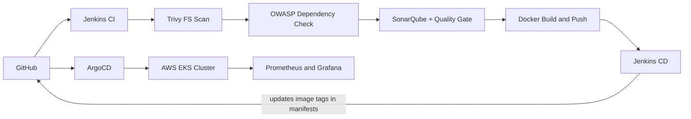

## Tech Stack

| Area | Tools |
|------|-------|
| Source control | GitHub |
| Infrastructure | Terraform (EC2), eksctl (EKS), AWS |
| CI/CD | Jenkins (Declarative Pipelines + Shared Library) |
| Security and quality | Trivy, OWASP Dependency-Check, SonarQube |
| Containers | Docker, DockerHub |
| Orchestration | Kubernetes (Amazon EKS) |
| GitOps | ArgoCD |
| Monitoring | Helm, Prometheus, Grafana |
| Notifications | Jenkins Email Extension (SMTP) |

---

## What I Did

### Phase 1: Infrastructure provisioning (Terraform)
1. Cloned the Wanderlust Mega Project repository locally.
2. Generated an SSH key pair with `ssh-keygen` and set its path in `ec2.tf`.
3. Ran `terraform init`, `terraform plan` and `terraform apply` to provision an **Ubuntu 24.04 EC2 instance** (master/control node).
4. Configured a Security Group for the ports used in this project: `22` (SSH), `8080` (Jenkins), `9000` (SonarQube), `3000` (Grafana), `9090` (Prometheus) and `30000-32767` (Kubernetes NodePort range).

### Phase 2: Tooling on the master EC2
1. Installed Java (JDK) and **Jenkins**.
2. Installed **Docker** and added the `jenkins` user to the `docker` group.
3. Installed **Trivy** and ran **SonarQube** as a Docker container.
4. Installed Jenkins plugins: OWASP Dependency-Check, SonarQube Scanner, Docker, Pipeline Stage View and Email Extension.
5. Configured Jenkins system settings: SonarQube server and token, tool installations, NVD API key for OWASP, and SMTP for email notifications.

### Phase 3: Kubernetes cluster (EKS)
1. Installed **AWS CLI**, **kubectl** and **eksctl** and configured AWS credentials.
2. Created the EKS cluster **`wanderlust`** with **2 worker nodes** in **us-east-2 (Ohio)** using `eksctl`.
3. Installed **ArgoCD** on the cluster, exposed its server, retrieved the initial admin password and logged in from the browser.

### Phase 4: Jenkins Shared Library and credentials
Reusable pipeline steps live in a separate repository, [Jenkins_SharedLib](https://github.com/Mirzasadaq/Jenkins_SharedLib), registered in Jenkins as a Global Pipeline Library:

`code_checkout`, `trivy_scan`, `owasp_dependency`, `sonarqube_analysis`, `sonarqube_code_quality`, `docker_build`, `docker_push`

Credentials stored in Jenkins: GitHub (`Github-cred`), DockerHub, NVD API key and email credentials.

### Phase 5: CI pipeline (`Wanderlust-CI`)
Defined in the root [`Jenkinsfile`](./Jenkinsfile):

1. Validate parameters (frontend and backend Docker tags)
2. Workspace cleanup
3. Git checkout
4. Trivy filesystem scan
5. OWASP Dependency-Check
6. SonarQube code analysis
7. SonarQube quality gate
8. In parallel, update backend and frontend environment files using the scripts in [`Automations/`](./Automations)
9. Docker build (backend and frontend)
10. Docker push to DockerHub
11. On success, archive the `.xml` reports and trigger the **`Wanderlust-CD`** job, passing the image tags

### Phase 6: CD pipeline (`Wanderlust-CD`)
Defined in [`GitOps/Jenkinsfile`](./GitOps/Jenkinsfile):

1. Workspace cleanup and Git checkout
2. Verify the Docker image tags received from CI
3. Update the image tags in `kubernetes/backend.yaml` and `kubernetes/frontend.yaml` using `sed`
4. Commit and push the updated manifests to GitHub
5. Send a success or failure email with build details

### Phase 7: GitOps deployment (ArgoCD)
1. Connected the GitHub repository to ArgoCD and created the application.
2. ArgoCD detected the manifest changes pushed by the CD pipeline and applied them to the cluster.
3. The app went live and was accessed in the browser at `<node-ip>:31000` (frontend). The backend runs on NodePort `31100`.

### Phase 8: Monitoring (Helm, Prometheus, Grafana)
1. Installed **Helm** and deployed the `kube-prometheus-stack` chart.
2. Changed the Prometheus and Grafana services from `ClusterIP` to `NodePort` with `kubectl patch`.
3. Accessed both dashboards at `<node-ip>:<node-port>`.

---

## My Customisations

- Pointed all pipelines, the shared library and the Kubernetes manifests to **my own** GitHub repositories and DockerHub account (`mirzasadaq/wanderlust-backend-beta`, `mirzasadaq/wanderlust-frontend-beta`).
- Wrote and tuned the CI and CD `Jenkinsfile`s, including parameter validation, quality gates, parallel environment-setup stages and a CI to CD trigger.
- Used `Automations/updatebackendnew.sh` and `updatefrontendnew.sh`, which fetch the EC2 public IP with the AWS CLI and update the `.env.docker` files.
- Configured the `owasp_dependency` shared library function to use an NVD API key stored as a Jenkins credential.
- Customised the heading text on the frontend home page (`frontend/src/pages/home-page.tsx`).

---

## Screenshots

### Application
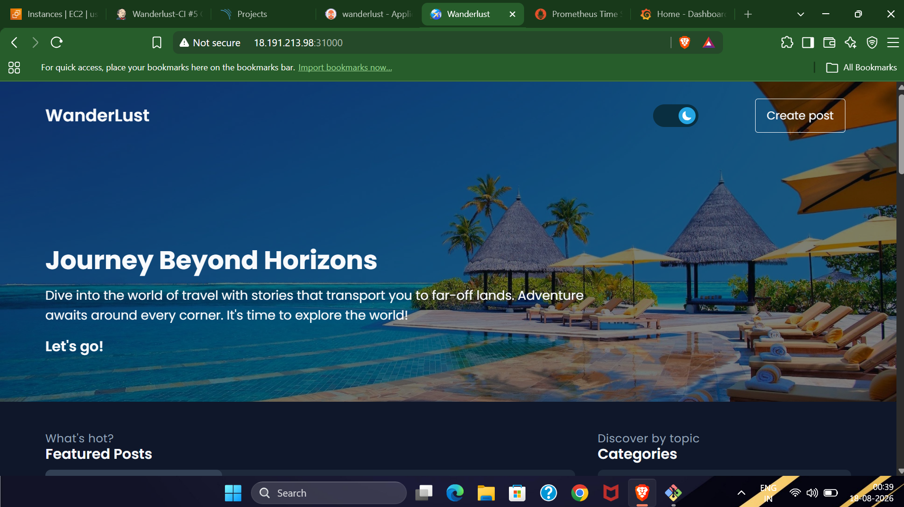
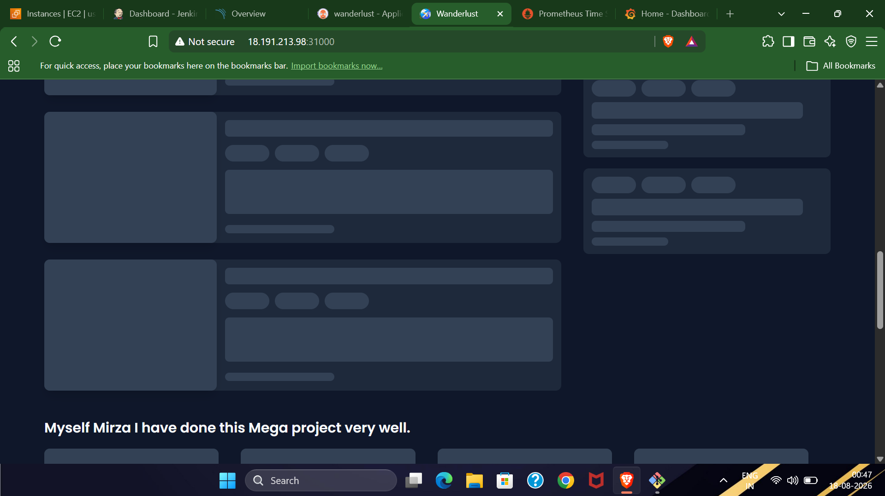

### Jenkins
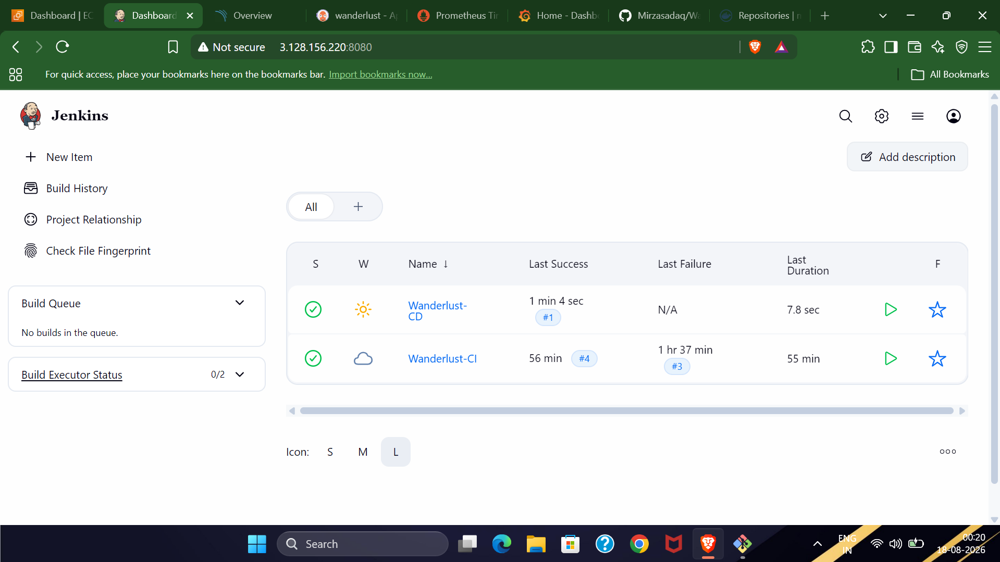

### CI pipeline
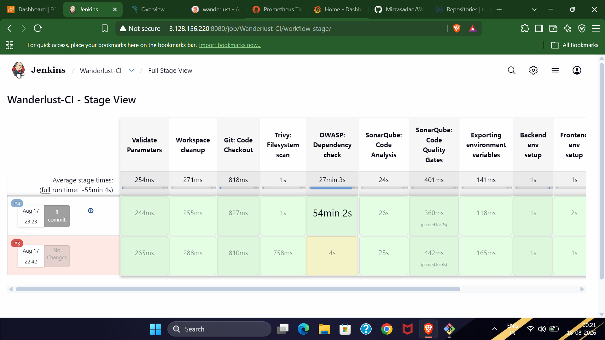
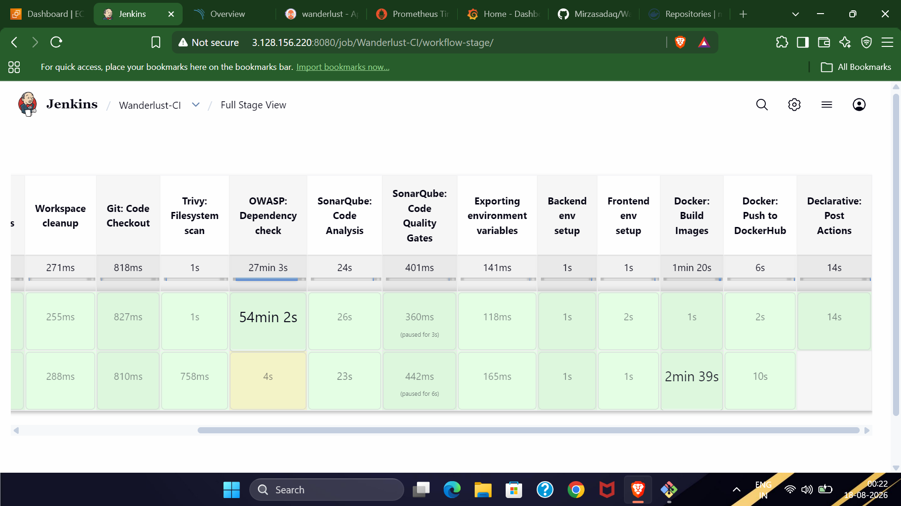

### OWASP Dependency-Check
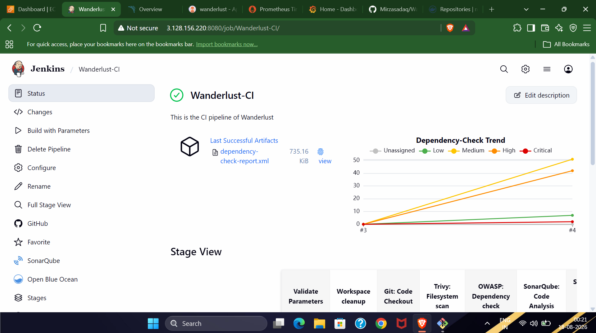

### SonarQube
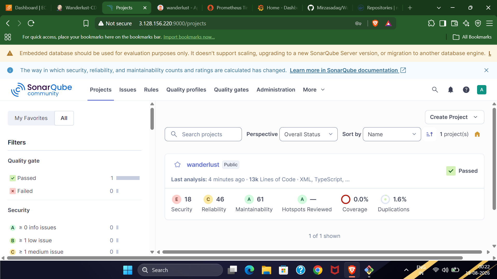
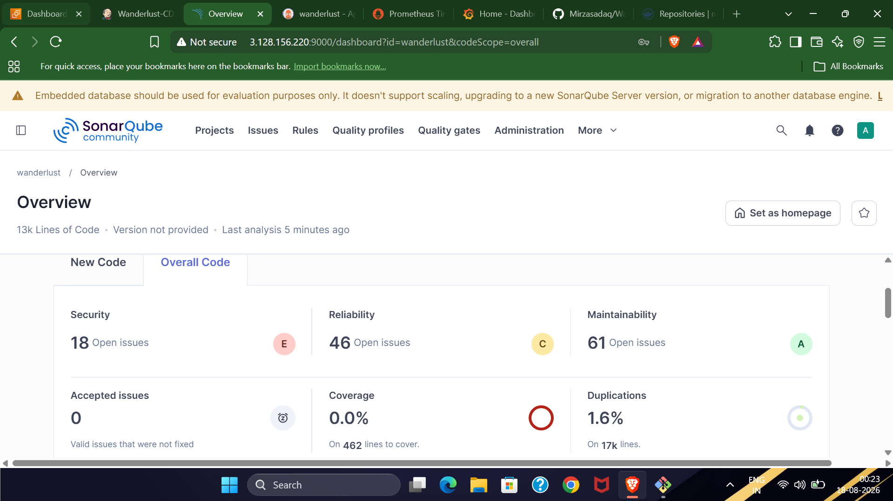

### CD pipeline
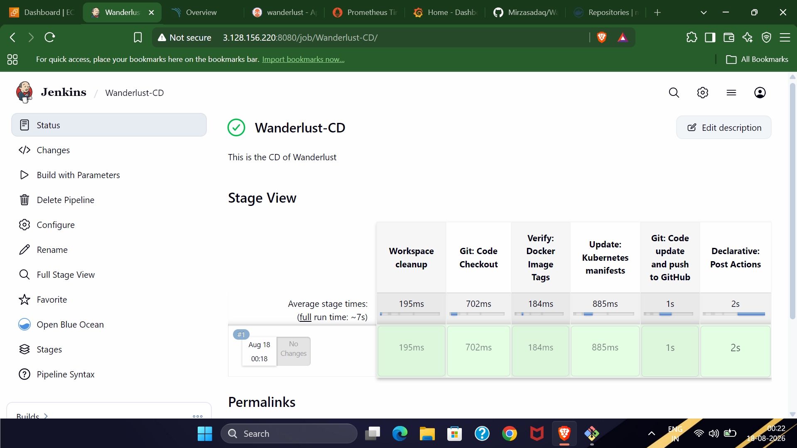

### ArgoCD
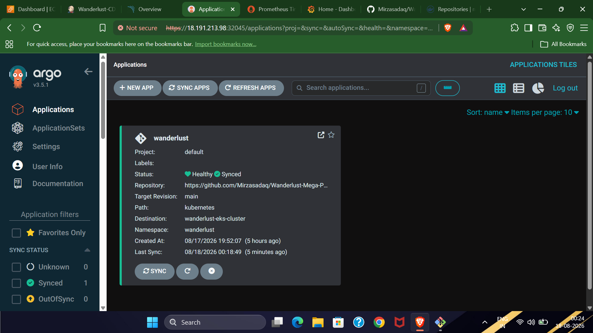
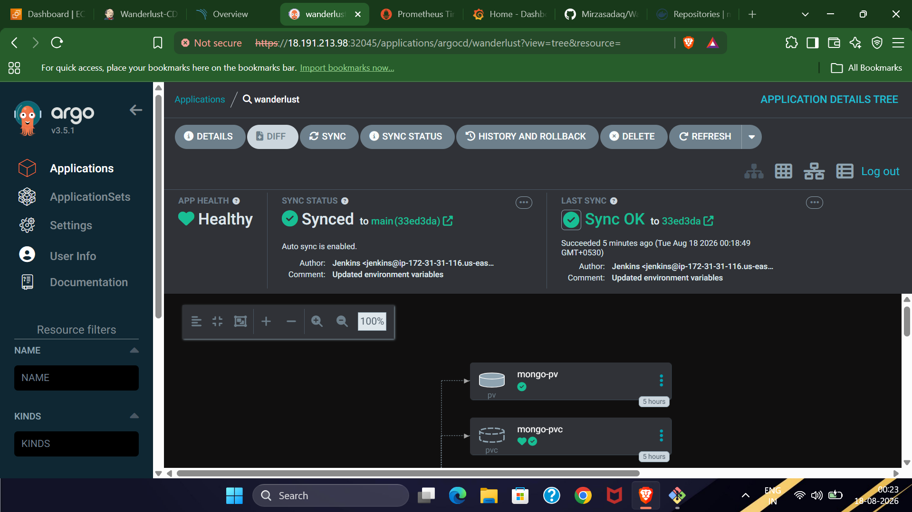

### Monitoring (Grafana)
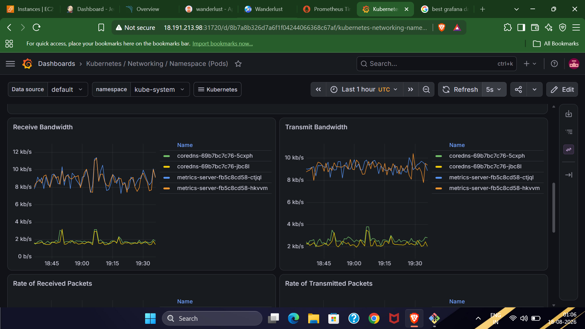
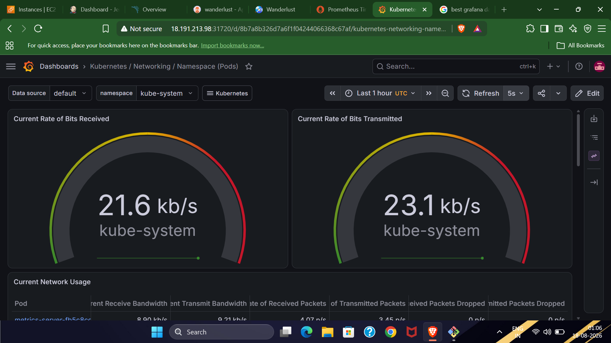

<!--
### Demo video
[Watch the ArgoCD walkthrough](PASTE_YOUR_YOUTUBE_LINK_HERE)
-->

---

## Troubleshooting

| Problem | What I did |
|---------|------------|
| `unable to configure AWS` error while cluster operations failed from Jenkins | Attached an **IAM Role** to the master EC2 instance (EKS/EC2 permissions) instead of relying only on CLI credentials |
| Multiple errors in the OWASP Dependency-Check stage | Final working setup uses the OWASP tool installation in Jenkins plus an NVD API key stored as a Jenkins credential (`nvd-api-key`), wired into the shared library |

---

## Clean Up

To avoid AWS charges, I deleted the resources after the demo:

```bash
eksctl delete cluster --name=wanderlust --region=us-east-2
```

---

## Future Improvements

- Move secrets such as the JWT secret from `.env.docker` into Kubernetes Secrets or a secrets manager.
- Replace the broad IAM permissions with a least-privilege IAM policy.
- Restrict Security Group sources to known IP ranges and put the app behind an Ingress with HTTPS.
- Provision the EKS cluster with Terraform as well, so the whole setup is code.

---

## Related Repositories

- [Jenkins_SharedLib](https://github.com/Mirzasadaq/Jenkins_SharedLib): reusable Jenkins pipeline functions used by this project

## Credits

- Application: [Wanderlust](https://github.com/krishnaacharyaa/wanderlust) by krishnaacharyaa
- Deployment reference: [DevMadhup/Wanderlust-Mega-Project](https://github.com/DevMadhup/Wanderlust-Mega-Project)
- Tutorial followed: Shubham Londhe

## About Me

**Mirza Sadique Baig**: aspiring DevOps Engineer.

- GitHub: [Mirzasadaq](https://github.com/Mirzasadaq)
- LinkedIn: [mirza-devops-engineer](https://www.linkedin.com/in/mirza-devops-engineer/)
